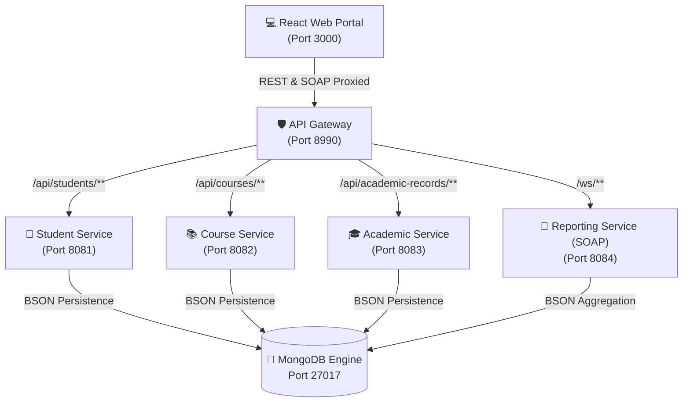

# 🚀 Smart Student Information System (SSIS) - Complete Execution & Verification Guide

> **A Comprehensive Operational Guide for Building, Launching, Testing, and Verifying the SSIS Microservices Architecture.**

---

## 📌 1. System Architecture & Port Allocation

The Smart Student Information System (SSIS) follows a reactive, microservices architecture with a unified React web portal, Spring Cloud Gateway API router, MongoDB persistence layer, and dual REST/SOAP communication engines.



---

### 🔌 Port Allocation Matrix

| Service Component | Technology Stack | Port | Base URL / Endpoint |
| :--- | :--- | :---: | :--- |
| **React Frontend** | React 18, Vite, Recharts, Lucide | `3000` | [http://localhost:3000](http://localhost:3000) |
| **API Gateway** | Spring Cloud Gateway | `8990` | [http://localhost:8990](http://localhost:8990) |
| **Student Microservice** | Spring Boot 3.3, Spring Data Mongo | `8081` | [http://localhost:8081](http://localhost:8081) |
| **Course Microservice** | Spring Boot 3.3, Spring Data Mongo | `8082` | [http://localhost:8082](http://localhost:8082) |
| **Academic Microservice** | Spring Boot 3.3, CGPA Calc Engine | `8083` | [http://localhost:8083](http://localhost:8083) |
| **Reporting Microservice** | Spring-WS, WSDL4J, JAXB (SOAP) | `8084` | [http://localhost:8084](http://localhost:8084) |
| **MongoDB Database** | MongoDB 8.0 Community Edition | `27017` | `mongodb://localhost:27017` |

---

## 🛠️ 2. Prerequisites & System Environment

Ensure the following runtimes and build tools are available on your environment PATH:

- **Java Development Kit**: JDK 21 (e.g. `C:\Users\saipr\.jdks\jbr-21.0.11`)
- **Build Tool**: Apache Maven 3.9+ (e.g. `C:\Users\saipr\apache-maven-3.9.9`)
- **Node Environment**: Node.js v18+ & npm v9+ (e.g. Node v22.14.0)
- **Database Engine**: MongoDB Server 8.0+ running at `mongodb://localhost:27017`

---

## 🏗️ 3. Building All Microservices

To compile all microservices and generate executable JAR packages, run the following PowerShell snippet from the workspace root:

```powershell
# Set Java 21 environment & Maven path
$env:JAVA_HOME="C:\Users\saipr\.jdks\jbr-21.0.11"
$mvn="C:\Users\saipr\apache-maven-3.9.9\bin\mvn.cmd"

# Build all 5 Spring Boot microservices
$services = @("api-gateway", "student-service", "course-service", "academic-service", "reporting-service")

foreach ($svc in $services) {
    Write-Host "Building $svc..." -ForegroundColor Cyan
    Push-Location $svc
    & $mvn clean package -DskipTests
    Pop-Location
}
```

### Verified Target Artifacts Checklist
- [x] `api-gateway/target/api-gateway-1.0.0.jar`
- [x] `student-service/target/student-service-1.0.0.jar`
- [x] `course-service/target/course-service-1.0.0.jar`
- [x] `academic-service/target/academic-service-1.0.0.jar`
- [x] `reporting-service/target/reporting-service-1.0.0.jar`

---

## 🚦 4. System Execution Procedure

### Step 1: Verify MongoDB Status
Confirm that the MongoDB service is active:
```powershell
& "C:\Users\saipr\AppData\Local\Programs\mongosh\mongosh.exe" --eval "db.adminCommand('ping')" --quiet
```
*Expected Output*: `{ ok: 1 }`

---

### Step 2: Launch Microservices
Launch each microservice in background background jobs or separate PowerShell consoles:

```powershell
$javaBin = "C:\Users\saipr\.jdks\jbr-21.0.11\bin\java.exe"

# 1. API Gateway (Port 8990)
Start-Process $javaBin -ArgumentList "-jar api-gateway/target/api-gateway-1.0.0.jar"

# 2. Student Service (Port 8081)
Start-Process $javaBin -ArgumentList "-jar student-service/target/student-service-1.0.0.jar"

# 3. Course Service (Port 8082)
Start-Process $javaBin -ArgumentList "-jar course-service/target/course-service-1.0.0.jar"

# 4. Academic Service (Port 8083)
Start-Process $javaBin -ArgumentList "-jar academic-service/target/academic-service-1.0.0.jar"

# 5. Reporting Service (Port 8084)
Start-Process $javaBin -ArgumentList "-jar reporting-service/target/reporting-service-1.0.0.jar"
```

---

### Step 3: Launch React Web Portal
In the `frontend` directory:
```powershell
cd frontend
npm install
npm run dev
```
Open your browser at: **`http://localhost:3000`**.

---

## 🧪 5. Verification & Validation Protocol

### A. Endpoint Health & Routing Verification
Run the following script to verify all service endpoints:

```powershell
$endpoints = @(
    'http://localhost:8990/api/students',
    'http://localhost:8081/api/students',
    'http://localhost:8082/api/courses',
    'http://localhost:8083/api/academic-records',
    'http://localhost:8084/ws/studentReport.wsdl',
    'http://localhost:3000'
)

foreach ($ep in $endpoints) {
    try {
        $r = Invoke-WebRequest -Uri $ep -UseBasicParsing -TimeoutSec 5
        Write-Host "SUCCESS [$($r.StatusCode)] -> $ep" -ForegroundColor Green
    } catch {
        Write-Host "FAILED -> $ep" -ForegroundColor Red
    }
}
```

---

### B. Seed Database Test
Populate MongoDB with demo data:
```powershell
Invoke-RestMethod -Uri "http://localhost:8990/api/students/seed" -Method Post
```
*Expected Output*:
`@{success=True; message=Demo student data seeded successfully; data=OK}`

---

### C. SOAP Protocol XML Execution
Query student report via SOAP XML payload over HTTP POST to `http://localhost:8990/ws`:

```powershell
$soapBody = @"
<soapenv:Envelope xmlns:soapenv="http://schemas.xmlsoap.org/soap/envelope/" xmlns:gs="http://ssis.com/reporting/soap">
   <soapenv:Header/>
   <soapenv:Body>
      <gs:getStudentReportRequest>
         <gs:studentId>STU001</gs:studentId>
      </gs:getStudentReportRequest>
   </soapenv:Body>
</soapenv:Envelope>
"@

$res = Invoke-WebRequest -Uri "http://localhost:8990/ws" -Method Post -ContentType "text/xml" -Body $soapBody -UseBasicParsing
$res.Content
```

*Sample Verified Response*:
```xml
<SOAP-ENV:Envelope xmlns:SOAP-ENV="http://schemas.xmlsoap.org/soap/envelope/">
   <SOAP-ENV:Body>
      <ns2:getStudentReportResponse xmlns:ns2="http://ssis.com/reporting/soap">
         <ns2:studentReport>
            <ns2:studentId>STU001</ns2:studentId>
            <ns2:studentName>Sai Praveen</ns2:studentName>
            <ns2:department>AIML</ns2:department>
            <ns2:cumulativeGradePointAverage>9.33</ns2:cumulativeGradePointAverage>
            <ns2:overallPerformance>Distinction / Outstanding</ns2:overallPerformance>
         </ns2:studentReport>
      </ns2:getStudentReportResponse>
   </SOAP-ENV:Body>
</SOAP-ENV:Envelope>
```

---

### D. Interactive UI Verification Sequence (7-Step Demo)

1. **Dashboard Overview**: Access [http://localhost:3000](http://localhost:3000). Click **Seed / Reset Demo Data** in the top navigation bar.
2. **Student Directory**: Select **Students**, search for `Sai`, register a new student (`STU015`), and view real-time document updates.
3. **Course Catalog**: Select **Courses**, view available courses (`AI201`, `CS401`), and edit credit allocations.
4. **Academic Evaluation Engine**: Select **Academic Records**, input Internal Marks (`36`) and External Marks (`56`). Observe dynamic calculation (`92 -> O Grade, 10 GP`).
5. **REST vs SOAP Showcase**: Select **REST & SOAP Reports**, choose student `STU001`, and click **Execute Both Protocols**. Compare raw XML SOAP vs JSON REST side-by-side.
6. **Swagger Documentation**: Open [http://localhost:8081/swagger-ui.html](http://localhost:8081/swagger-ui.html) to interact with OpenAPI endpoints.
7. **Postman Collection**: Import `postman/SSIS_Postman_Collection.json` into Postman to execute negative error testing (`404 Not Found`, `400 Bad Request`).

---

## 🔍 6. Common Issues & Troubleshooting

| Issue / Symptom | Root Cause | Solution |
| :--- | :--- | :--- |
| `Port 8080 occupied by Apache httpd` | Default web server running on port 8080. | SSIS API Gateway is configured on **Port 8990** to prevent conflicts. Access gateway at `http://localhost:8990`. |
| `Connection refused: mongodb://localhost:27017` | MongoDB service stopped. | Start MongoDB from Services app or run `net start MongoDB`. |
| `404 Not Found on SOAP Endpoint` | Request tag casing mismatch. | Use `<gs:getStudentReportRequest>` (lowercase `g`) as specified in `studentReport.wsdl`. |
| `CORS Policy Error` | Direct microservice access blocked by browser. | Route calls through API Gateway on port `8990` or Vite proxy on port `3000`. |
