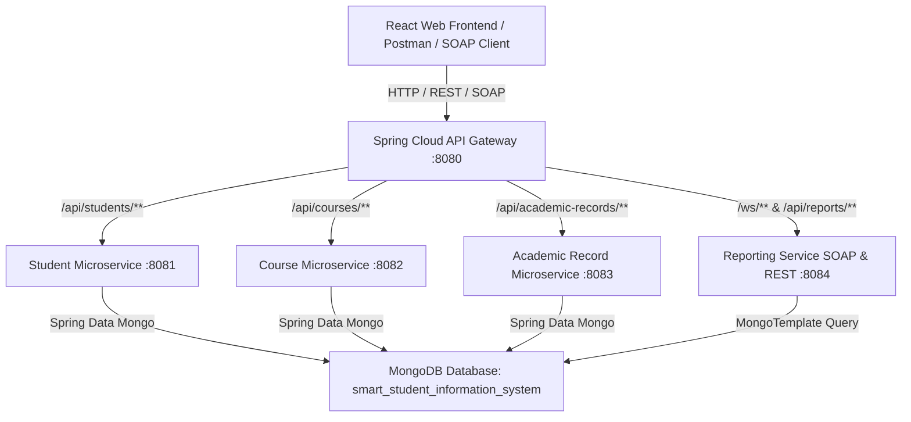
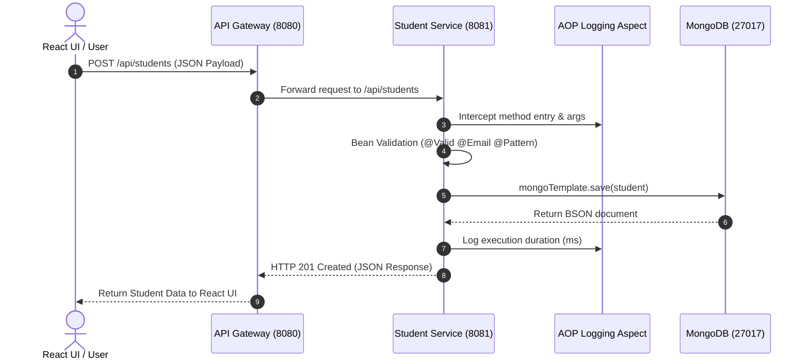
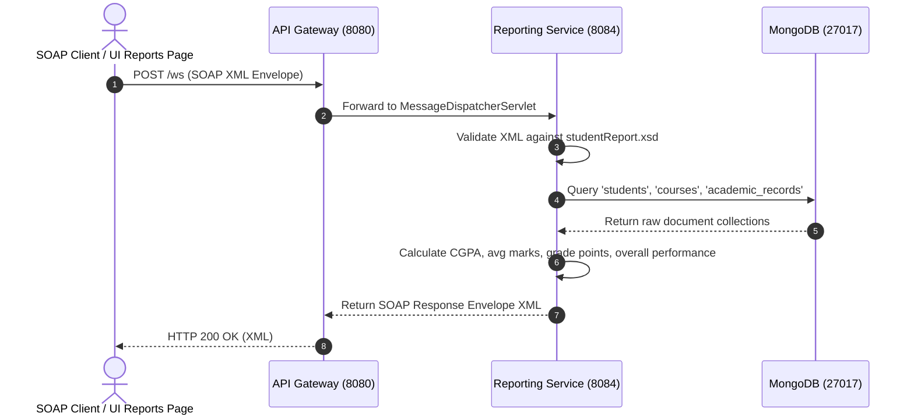

# System Architecture Documentation

The **Smart Student Information System (SSIS)** is built as a modular microservices solution on Java 21, Spring Boot 3.3, Spring Data MongoDB, and React.

---

## 1. System Topology & Request Flows

---

## 2. REST Request Sequence Flow

---

## 3. SOAP Request Sequence Flow

